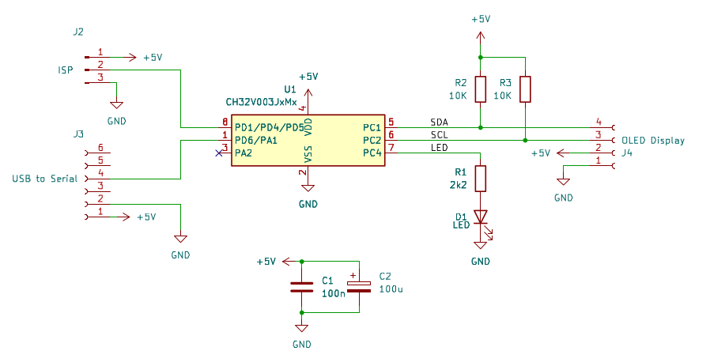

# OLED Display Tester #

Test tool for SSD1306/SH1106 OLED display modules, either 128x64 or 128x32 pixels. 

## Schematics

## Instructions

### 1. Power on

- Connect the USB to serial adapter to the circuit
- Adjust the serial port to 115200 bps, 8n1
- Connect the display to the connector and observe the screen.

Note (if no usb-serial is available, connect only a 5V power supply to the circuit)

### 2. Diagnotics

- The LED will power on whenever a device answers on I2C bus
- Observe if the display will turn on and show some stuff. The display will start by showing the current Driver, I2C address and Resolution.
- Then the display shall fill the screen. Check for dead pixels.
- Then the display shall fill every odd line in the sreen. Check for dead pixels on odd lines.
- Then the display shall fill every even line in the sreen. Check for dead pixels on even lines.
- The display will advance to the next mode then return to beginning.

Note: the test sequence is:

- SSD1306 @ 128x32
- SSD1306 @ 128x64
- SH1106 @ 128x32 
- SH1106 @ 128x64

