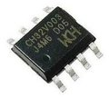
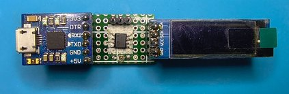
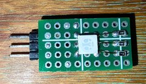
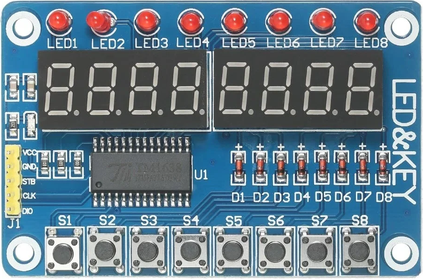

# CH32V003J4M6-things #

### Small projects for the smallest RISC-V microcontroller 

---

## OLED Display Tester
Test tool for SSD1306/SH1106 OLED display modules, either 128x64 or 128x32 pixels.
(Mounriver Studio)

## GLOW
LED glower for RGB LED or Neopixel (WS2812) (Mounriver Studio). 

 

## TM1638 Prop Bomb
Electronic bomb simulator designed for Airsoft matches.

 

